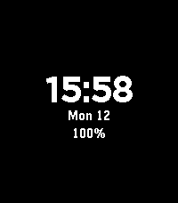
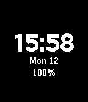
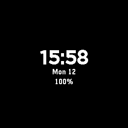

# pebble-dev-skill

**一个给 AI 编码智能体用的 Pebble 手表开发 skill** —— 附带一套**用模拟器实测验证过**的起始工程和验证方法论。

[](https://github.com/pandamakipanda/pebble-dev-skill/actions/workflows/checks.yml)
[](https://github.com/pandamakipanda/pebble-dev-skill/actions/workflows/build-pbw.yml)
[](https://github.com/pandamakipanda/pebble-dev-skill/actions/workflows/render.yml)
[](LICENSE)

<p align="center">
  
  
  
  
</p>
<p align="center"><em>起始工程在四个平台上的实拍（Pebble QEMU 模拟器渲染，非设计稿）</em></p>

---

## 这是什么

Pebble（2016 年停产、2025 年由 Core Devices 复活）用 C 写手表应用，产物是 `.pbw` 包。
本仓库解决一个具体问题：**怎么让 AI 写的 Pebble C 代码不出 bug。**

答案不是"写更好的提示词"，而是三件工程上的事：

1. **把易错逻辑抽成不含 `pebble.h` 的纯 C 模块** —— 这样它能在 PC 上被单元测试覆盖；
2. **用变异测试证明测试本身有效** —— `make test` 全绿只说明测试没报警，不说明它有能力报警；
3. **上模拟器截图** —— 结构断言永远抓不到"合法但难看"的问题。

这三条不是空谈：我们用这套方法在自己的代码里抓出了 **10+ 个真 bug**，包括一个"重新加载表盘整屏空白"和一个"三行字全挤到屏幕底部"的视觉回归。

## 快速开始

### 作为 skill 用（给 AI 智能体）

把 `skill/pebble-dev/` 整个目录放进你的 agent skill 目录：

```bash
# DSH / Claude Code / 任何读 ~/.dsh/skills 或 ~/.claude/skills 的工具
mkdir -p ~/.dsh/skills
cp -r skill/pebble-dev ~/.dsh/skills/       # 目录名必须与 SKILL.md 里的 name 一致
```

起始工程随 skill 一起走（`skill/pebble-dev/starter/`），所以 agent 能直接抄模板。

Claude Code / Codex / Cursor 等支持 `AGENTS.md` 或 skills 目录的工具同理。
`SKILL.md` 的 frontmatter 里写了触发条件（Pebble / `.pbw` / watchface / Rebble / Core Devices）。

### 作为模板用（直接开发）

```bash
cp -r skill/pebble-dev/starter/my-watchface ~/my-watchface && cd ~/my-watchface

# 必改：package.json 里的 uuid / name / displayName / targetPlatforms
make test        # 格式化 18,286 + 布局 2,554,681 检查点
make mutate      # 变异测试：注入 20 个已知 bug，验证测试抓得到
pebble build     # -> build/my-watchface.pbw
make verify      # 产物健全性检查（构建成功 ≠ 产物可用）
```

## 环境要求

```bash
uv tool install pebble-tool --python 3.13     # 5.0.18+ 尚不支持 Python 3.14
pebble sdk install latest                     # 或 4.33.1
```

Ubuntu 系统依赖：`python3-pip python3-venv nodejs npm libsdl1.2debian libfdt1`。

> **arm64 上注意**：`pip install pebble-tool` 会因 `pypkjs` → `stpyv8` 失败
> （PyPI 上 `stpyv8` 只有 x86_64/macOS/Windows 轮子）。绕法见
> [`SKILL.md` 第二节](skill/pebble-dev/SKILL.md)。
> 官方下载服务器提供 `toolchain-linux-aarch64.tar.gz`，**arm64 上能完整构建**。

## 仓库内容

| 路径 | 说明 |
|---|---|
| [`skill/pebble-dev/SKILL.md`](skill/pebble-dev/SKILL.md) | **主体**：环境搭建、决策树、API 语义速查、验证方法论、踩坑清单 |
| [`docs/pebble-ai-dev-guide.md`](docs/pebble-ai-dev-guide.md) | 更完整的学习文档（591 行，10 章） |
| [`skill/pebble-dev/starter/my-watchface/`](skill/pebble-dev/starter/my-watchface/) | 起始工程：真实可构建的表盘 + 四层验证 |
| [`emulator-toolkit/`](emulator-toolkit/) | 无显示器环境跑 Pebble 模拟器 + 截图（含全部踩坑） |

## 为什么值得看：几个反直觉的实测结论

这些都是真跑出来的，不是推测：

- **"手写格式化替代 `snprintf`/`strftime` 以省体积"是错的。** 那些函数在 `libpebble.a` 里是 **12 字节的 syscall 桩**，未被引用就被 `--gc-sections` 丢掉 ⇒ 边际成本≈0，手写反而净增代码。
- **`MINUTE_UNIT` 减少的是"用户回调次数"，不是"进程唤醒次数"。** 反汇编 `tick_timer_add_subscriber()` 可见：任何 tick 订阅都让 app 挂在同一个 1 Hz 事件流上。
- **`.`pbw` 里 57–60% 的体积是"每平台一份 4092 字节空资源包"**（四平台 md5 完全相同，内容是 `00000000 ffffffff` + 4084 个 0）。唯一有效手段是减平台：**每减一个省约 7,130 字节**。
- **LTO 会把包做废。** 加 `-flto` 后 `.text` 降 12%、构建报成功，但 `pebble-app.bin` 开头没有 `PBLAPP` 元数据头 —— 因为 `inject_metadata.py` 是原地改写 objcopy 的产物，而 LTO 下目标文件是 GIMPLE 字节码。**装到手表直接失败。**
- **`FONT_KEY_BITHAM_*_NUMBERS` 是数字子集字体**，冒号等标点不保证有字形，`HH:MM` 会渲染成豆腐块。

## 验证方法论（本仓库的核心）

```
逻辑正确性  纯 C 模块 + 单元测试 + 与标准库差分对拍    18,286 检查点
几何正确性  布局抽成纯函数，穷举行高 × 屏幕尺寸        2,554,681 检查点
测试有效性  变异测试：注入 20 个已知 bug              20/20 抓到, 0 逃逸
产物可用性  PBLAPP 魔数 + 元数据解析 + manifest 交叉核对   verify_pbw.py
视觉正确性  模拟器实渲染 + 画面断言（CI 四平台）          test_render.py  12 检查点
```

**视觉那一层不是锦上添花，它抓的是别人抓不到的东西。** 我们真实踩过一次回归：
把布局从"比例分布"改成"紧凑堆叠"后，三行文字**全部挤到屏幕底部、上方 2/3 全黑**。
它不越界、不重叠、非零高 —— **通过了当时所有结构断言**，只有截图才发现。

现在的渲染断言会直接拦下它（`make render`）：

```
✗ 垂直分布均衡（上留白 157 / 下留白 2，差 155）
```

这条判据的细节值得记一下：**不要用"字形行范围"判断布局**。42pt 数字的字形只占
层高的一部分，居中与贴底两种布局的**字形行范围可能重合**（我们被这点误导过一次）。
上下**留白差值**才是可靠判据。

渲染测试还有个关键设计：从 SDK 的 `qemu_spi_flash.bin.bz2` 解出**出厂镜像**再启动
（`--pristine-flash`），这样 `before` 是灰色出厂画面、`after` 是黑底表盘，
**能证明"我的 app 真的渲染了"**，而不只是"屏幕上本来就有东西"。
（踩过的坑：pebble-tool 持久目录里那份 flash 可能已经带着上次装的 app，
所谓"全新 flash"启动后直接显示旧表盘。）

**关键信念：`make test` 全绿不能证明测试有效。** 我们第一轮变异测试就逃逸了 3 个变异体
（`fmt_changed` 恒真、越界输入不夹取、小缓冲越界写全都没被覆盖），补完用例才 20/20。

## 贡献

欢迎 PR。请先读 [CONTRIBUTING.md](CONTRIBUTING.md)；跑 `make test && make mutate` 保证不回归。
发现安全问题请看 [SECURITY.md](SECURITY.md)。

## 许可与致谢

本项目以 [MIT](LICENSE) 许可发布。

- Pebble SDK / PebbleOS 由 [Core Devices](https://github.com/coredevices) 与 [Rebble](https://rebble.io) 维护，遵循各自的许可证。
- 官方开发者文档：[developer.rebble.io](https://developer.rebble.io/)
- 官方也有一个 agent skill 仓库：[coredevices/pebble-watchface-agent-skill](https://github.com/coredevices/pebble-watchface-agent-skill)，结构上我们做了对齐。
- 本项目与 Core Devices / Pebble / Rebble 无隶属关系，是社区作品。

---

## English summary

**A Pebble smartwatch development skill for AI coding agents**, plus a
**simulator-verified** starter project and a testing methodology.

Pebble (discontinued 2016, revived by Core Devices in 2025) apps are written in C
and shipped as `.pbw` bundles. This repo answers one question: *how do you keep
AI-generated Pebble C code from being broken?*

Not with better prompts — with three engineering practices:

1. **Extract error-prone logic into pure C modules** that don't include `pebble.h`,
   so they can be unit-tested on the host.
2. **Prove your tests actually work with mutation testing.** A green `make test`
   only means the tests didn't complain, not that they *can* complain.
3. **Screenshot the emulator.** Structural assertions can never catch
   "legal but ugly" layout regressions.

Applying these caught **10+ real bugs** in our own code, including a
"reload → blank screen" bug and a "three text rows crammed at the bottom" visual
regression that passed every structural assertion.

**Counter-intuitive findings** (all measured, not guessed):

- Replacing `snprintf`/`strftime` with hand-rolled formatters to **save code size
  does not work** on Pebble — those are 12-byte syscall stubs in `libpebble.a`
  that get garbage-collected when unused.
- `MINUTE_UNIT` reduces **user callbacks**, not **wakeups** — any tick
  subscription rides the same 1 Hz kernel event stream.
- 57–60% of a `.pbw` is a **fixed 4092-byte empty resource pack per platform**.
  The only real lever is dropping `targetPlatforms` (~7,130 bytes each).
- **Enabling LTO produces a broken bundle** while still reporting build success.

**Verify counts:** 18,286 format checks · 2,554,681 layout checks ·
20/20 mutants caught · 4 platforms screenshot-verified.

MIT licensed. Not affiliated with Core Devices / Pebble / Rebble.
